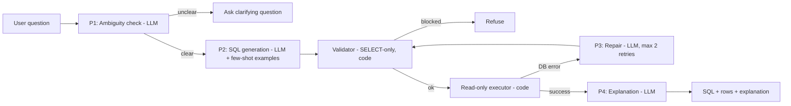

# AskDB (Vortex-SchemaSense-SQL)

### Ask your database in plain English. Get safe, read-only SQL, the result, and a simple explanation.

**Team Vortex** | Prompt Engineering Project | Problem ID: **C8** (Natural Language to SQL)


[Prototype](#-links) | [Demo Reel](#-links) | [Results](#-results) | [Team](#-team-vortex)


---

## Table of Contents

1. [The Problem](#-the-problem)
2. [What AskDB Does](#-what-askdb-does)
3. [How It Works](#-how-it-works)
4. [Safety by Design](#-safety-by-design)
5. [Prompt Engineering Journey](#-prompt-engineering-journey)
6. [Results](#-results)
7. [Project Structure](#-project-structure)
8. [Getting Started](#-getting-started)
9. [Example Session](#-example-session)
10. [Limitations and Honest Notes](#-limitations-and-honest-notes)
11. [Future Work](#-future-work)
12. [Team Vortex](#-team-vortex)
13. [Links](#-links)

---

## The Problem

In almost every sector (retail, banking, healthcare operations, HR, education) the data lives in relational databases. But most people who need answers from that data **cannot write SQL**. Every report depends on a small group of analysts, so requests get delayed or misunderstood.

Text-to-SQL is also **not a solved problem**. Benchmarks such as [BIRD](https://neurips.cc/virtual/2023/poster/73529) (12,751 question-SQL pairs across 95 databases) show that even strong prompting methods reach only moderate execution accuracy, which is why careful prompt design and safety checks matter.

**Our goal:** let a non-technical user type a question and get a *correct, safe, checkable* answer.

## What AskDB Does

| You give | AskDB returns |
|---|---|
| A plain-English question about the database | A read-only SQL query, its result, and a short plain-English explanation |
| A vague question such as "Who are our top customers?" | A **clarifying question** instead of a guess |
| A harmful or impossible request such as "Update all prices to 0" | A **safe refusal**, and nothing is executed |

The generated SQL is always shown **beside** the answer so a human can verify it.

## How It Works

AskDB is a multi-step prompt pipeline. Four steps use an LLM, and two steps are plain code.



| Step | Type | Job |
|---|---|---|
| **P1** Ambiguity check | LLM prompt | Detects vague words like "top", "best", "recent" with no metric and asks one follow-up question |
| **P2** SQL generation | LLM prompt | Writes exactly one SELECT query using worked examples and a described schema |
| **Validator** | Code (`sqlglot`) | Parses the SQL and allows exactly one SELECT statement |
| **Executor** | Code | Runs the query on a read-only SQLite connection |
| **P3** Repair | LLM prompt | Receives the database error and fixes the query (max 2 retries) |
| **P4** Explanation | LLM prompt | Explains the result in 2 to 3 plain sentences, using only the returned values |

## Safety by Design

Safety is built into the pipeline, not added at the end.

- **Prompt layer:** P2 is told to return `null` for anything that changes data or cannot be answered from the schema.
- **Parser layer:** a `sqlglot` validator rejects anything that is not exactly one SELECT, including INSERT, UPDATE, DELETE, DROP, CREATE, ALTER and multiple statements.
- **Database layer:** queries run on a read-only executor.
- **Data layer:** the database is fully **synthetic**. No real personal data is used anywhere.
- **Transparency:** the SQL is shown with every answer.

## Prompt Engineering Journey

We improved the SQL-generation prompt one change at a time and re-ran the same 12 tests after each version.

| Version | What we changed | Why |
|---|---|---|
| **v1** | Baseline: "You are a SQL assistant", plain schema, free-text reply | Starting point |
| **v2** | Role and 5 rules, JSON-only output, described schema with column notes | v1 invented a `birthday` column and its free-text output was hard to parse |
| **v3** | 4 worked few-shot examples, date-format rule, temperature 0 | Improve consistency on joins and date logic |
| **final** | Added P1 ambiguity check, P3 repair, P4 explanation | Vague questions like "top customers" were being guessed instead of clarified |

Prompt files are in `prompts/v1`, `prompts/v2`, `prompts/v3` and `prompts/final`.

## Results

12 test cases: **6 Normal, 3 Edge, 3 Invalid**. A test passes if the SQL returns the same rows as the gold SQL, if the system asks a clarifying question (ambiguous input), or if the request is blocked or refused (invalid input).

| Version | Passed | Notes |
|---|:---:|---|
| v1 | **9 / 12** | Guessed "top" customers, invented a birthday column |
| v2 | **10 / 12** | Invalid requests now refused correctly |
| v3 | **11 / 12** | Few-shot examples fixed the Electronics join case |
| final | **11 / 12** | Ambiguity check now asks about "top customers" |

Raw outputs for each run are saved in [`test-data/results/`](test-data/results/).

## Project Structure

```
Vortex-SchemaSense-SQL/
├── code/
│   ├── pipeline.py        # Main pipeline (P1 -> P2 -> validate -> run -> P3 -> P4)
│   ├── validator.py       # SELECT-only safety check (sqlglot)
│   ├── db.py              # Synthetic retail database + read-only executor
│   ├── llm.py             # Only file that talks to a model (provider via env vars)
│   ├── prompts.py         # Prompt loader and per-version settings
│   ├── run_tests.py       # Runs the 12 tests for a version
│   └── demo.py            # Interactive demo
├── prompts/
│   ├── v1/ v2/ v3/        # Earlier SQL-generation prompts
│   └── final/             # P1 ambiguity, P2 SQL, P3 repair, P4 explanation
├── test-data/
│   ├── test_cases.json    # 12 test inputs with gold SQL
│   └── results/           # Saved outputs of each run
├── docs/                  # Diagrams and the Milestone 2 PDF
├── CHANGELOG.md
├── requirements.txt
└── .env.example
```

## Getting Started

### 1. Clone and install

```bash
git clone https://github.com/YOUR-USERNAME/Vortex-SchemaSense-SQL.git
cd Vortex-SchemaSense-SQL
pip install sqlglot
pip install anthropic      # or: openai | google-genai (install only the one you use)
```

### 2. Set your model (no API key is included in this repo)

```bash
export LLM_PROVIDER=anthropic          # anthropic | openai | gemini
export MODEL_NAME=YOUR_MODEL_NAME     # exact model name from your provider dashboard
export ANTHROPIC_API_KEY=YOUR_KEY     # use the key for your own provider
```

On Windows PowerShell, use `$env:LLM_PROVIDER="anthropic"` instead of `export`. See `.env.example` for all variables. **Never commit your keys.**

### 3. Build the database and run

```bash
python code/db.py                # builds data/retail.db (synthetic data)
python code/run_tests.py v1      # then v2, v3, final
python code/demo.py              # interactive demo
```

## Example Session

```text
Question> How many customers are there?
SQL: SELECT COUNT(*) FROM customers;
Answer: There are 8 customers in the database.

Question> Who are our top customers?
Clarifying question: What metric defines "top" customers (total spend, number of
orders, average order value) and how many would you like to see?

Question> Update the price of every product to 0.
Not run (no_answer): Only read-only SELECT queries are allowed.
```

## Limitations and Honest Notes

We would rather report what did not work than hide it.

- **One test is inconsistent.** Test 8 ("customers who bought Electronics") sometimes returns an extra `customer_id` column next to `name`, so it fails the row comparison on some runs even though the logic is right. It passed in v3 and failed in the final run with the same P2 prompt, which shows run-to-run variation.
- **Small scope.** The prototype uses one synthetic retail database (8 customers, 8 products, 15 orders) and 12 test cases. Scores on this set do not predict performance on large real-world databases.
- **Reduced from our proposal.** Our original plan included Spider/BIRD subsets, schema linking, retrieved few-shot examples and three model families. After mentor feedback that six stages was ambitious for three weeks, we narrowed the scope to test each stage properly.
- **Repair and explanation coverage.** The repair step (P3) and explanation step (P4) are implemented, but our saved test runs do not exercise them heavily: no test required a repair, and explanations run in the demo rather than the test runner.
- **Always check the SQL.** AskDB shows the query beside every answer so a person can verify it.

## Future Work

- Add schema linking and pruning for larger databases
- Retrieve few-shot examples that are similar to the user's question
- Compare several model families with identical prompts
- Evaluate on Spider and BIRD subsets
- Add tests that deliberately trigger the repair step
- Build a simple web interface

## Team Vortex

| Enrollment No. | Name | Role |
|---|---|---|
| S24CSEU0056 | **Kushagra Agrawal** (Team Lead) | Prompt design and iteration log |
| S24CSEU0189 | Vishva Chauvisa | Prototype code and demo link |
| S24CSEU1577 | Akshej Gupta | Testing and failure analysis |
| S24CSEU0179 | Viduit Dev Raj Saini | Technical report and Milestone 2 PDF |
| S24CSEU0079 | Tejaswita Tiwari | Reel recording and editing |
| S24CSEU1567 | Priyanshu Saini | Architecture diagram and documentation |

## Links

| | |
|---|---|
| Prototype | `[paste prototype link]` |
| Demo reel | `[paste reel link]` |
| Milestone 2 PDF | `docs/` |

---

Built by **Team Vortex**. All data is synthetic and all queries are read-only.